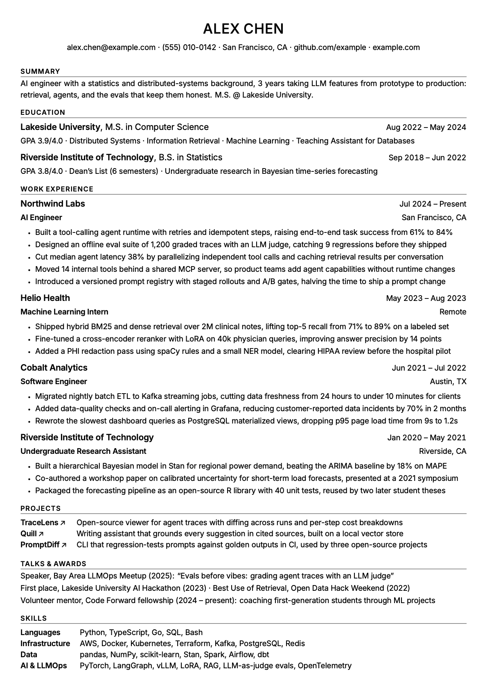
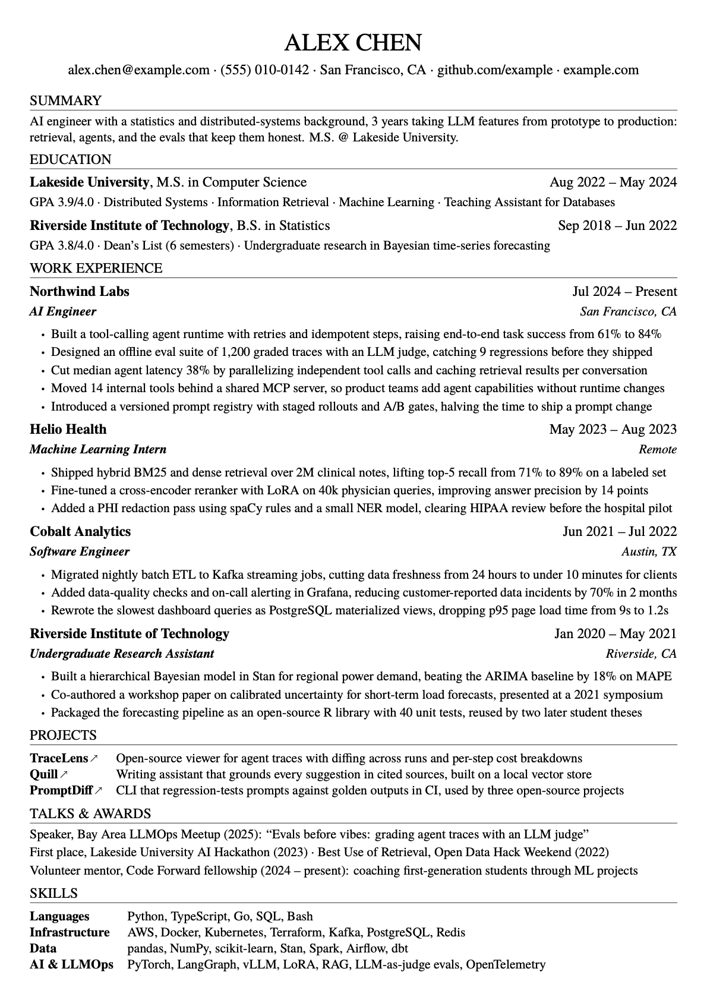

# resumectl

**A harness for agent-written résumés.**

Paste in a job description and your background. Your coding agent (Claude Code, Codex, Cursor and similar) writes a tailored one-page résumé in LaTeX, renders it, and keeps revising until the PDF passes every check: it fits the page, has no ragged last lines, and parses cleanly in an ATS. Every claim comes from facts you gave it, so it can't invent metrics.

| Sans (recommended) | Serif |
|---|---|
|  |  |

<sub>Example people, schools and companies are fictional.</sub>

## Why

- **LaTeX, not Word.** Typesetting is far better, and you never fight Word's interface.
- **LaTeX suits agents, with a harness to keep them in line.** A `.tex` file is plain text, so an agent can edit it precisely. Left alone, though, it overflows the page and pads bullets. resumectl measures the rendered PDF and makes the build fail until the content fits.
- **Plain by design.** No icons, colour bars or two-column gimmicks. There are two typefaces with carefully tuned sizes and weights. I prefer the sans because it's easier to read on screen, where résumés are actually read. Both styles are single-column, real text and ATS-friendly.

## Get started

**1. Install the prerequisites:** [Bun](https://bun.sh) ≥ 1.3 and XeLaTeX. [Setup](docs/setup.md) has a lightweight TeX install (about 290 MB).

**2. Clone this repository and check the toolchain:**

```bash
git clone https://github.com/nickhuo/resumectl.git
cd resumectl
bun install
bun run resumectl doctor
```

**3. Open your coding agent in the folder and ask:**

> Make me a résumé for this job. Use the sans style.
>
> Job description: *(paste)*
>
> My background: *(paste your old résumé, LinkedIn, notes, project write-ups)*

The agent picks up the writing method from [`AGENTS.md`](AGENTS.md) automatically. It maps the job's requirements to your evidence and asks about any gaps instead of guessing. Then it writes the content, builds the PDF, and revises until the build passes. Your PDF ends up in `my-resume/output/resume.pdf`, or in whichever folder you named.

To use the method from a different folder, copy [`skills/resume-methodology/`](skills/resume-methodology/) into your agent's skills directory.

## What the build checks

| Check | Default |
|---|---|
| Page budget | 1 page |
| Entry length | Up to 2 lines per bullet, last line at least 80% full, no overflow |
| Copyable text | Text copied out of the PDF matches the page (phone numbers, names, brackets) |

You can change any limit per section in `resume.config.yaml`, and mark sections such as Education as off-limits to the agent. See [configuration](docs/configuration.md).

## Editing by hand

```bash
bun run resumectl init ./my-resume --style sans # starter resume.tex + config
bun run resumectl build ./my-resume/resume.tex  # compile and run every check
```

Fonts, sizes, margins and LaTeX commands are documented in [rendering](docs/rendering.md).

## License

[MIT](LICENSE). Inter is bundled under the [SIL Open Font License](template/fonts/OFL-Inter.txt). TeX Gyre Termes comes from your TeX distribution.
