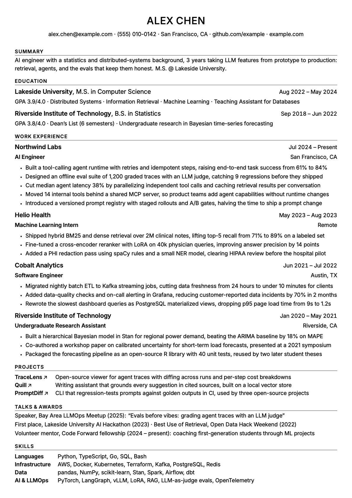
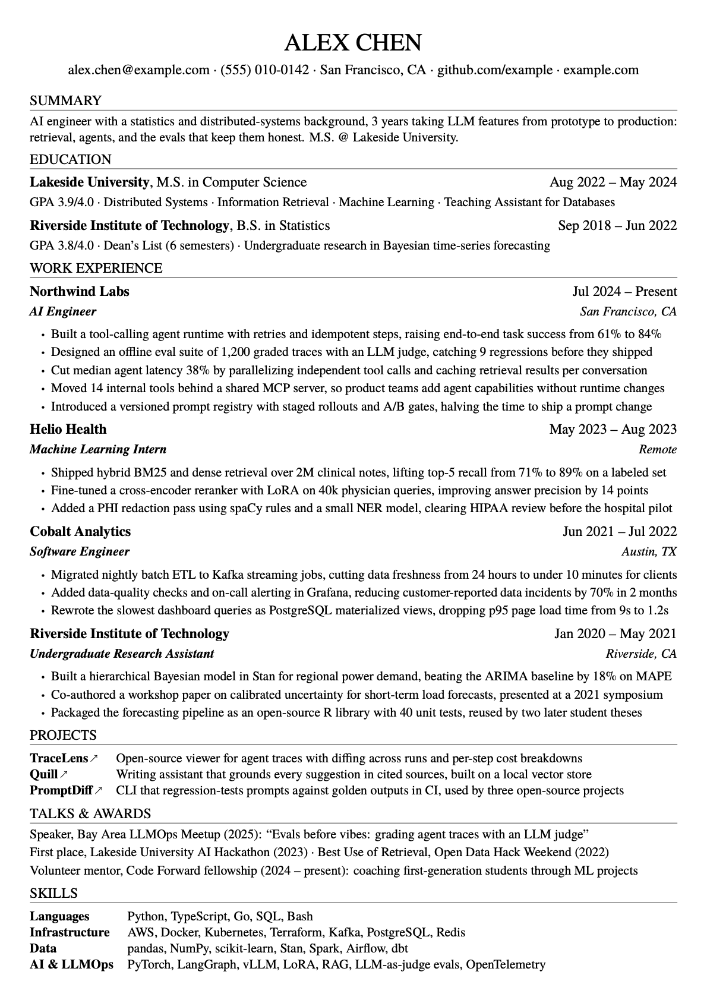

# resumectl

**A harness for agent-written résumés.**

Paste in a job description and your background. Your coding agent (Claude Code, Codex, Cursor and similar) writes a tailored one-page résumé in LaTeX, renders it, and keeps revising until the PDF passes every check: it fits the page, has no ragged last lines, and parses cleanly in an ATS. Every claim comes from facts you gave it, so it can't invent metrics.

| Sans (recommended) | Serif |
|---|---|
|  |  |

<sub>Example people, schools and companies are fictional.</sub>

## Why

- **LaTeX, not Word.** Typesetting is far better, and you never fight Word's interface.
- **LaTeX suits agents, with a harness to keep them in line.** A `.tex` file is plain text, so an agent can edit it precisely. Left alone, though, it overflows the page and pads bullets. resumectl measures the rendered PDF and makes the build fail until the content fits.
- **Plain by design.** No icons, colour bars or two-column gimmicks. There are two typefaces with carefully tuned sizes and weights. I prefer the sans because it's easier to read on screen, where résumés are actually read. Both styles are single-column, real text and ATS-friendly.

## How I think about résumés

A résumé is one of the biggest levers in a career. It condenses the best of your past onto one page, and that page is how a stranger decides whether to trust you.

I've always treated it as a serious craft, while many people treat it as paperwork to get through. Three less common ways to look at it:

1. **Your résumé shows every career decision you've made.** Every wrong call on industry, field or company is plainly visible on the page. If you can tell the story of how you made those decisions, and make it interesting, logical and convincing, it becomes one of the strongest parts of your interview. If you tell it badly, or don't tell it at all, it counts against you.
2. **A résumé is an icebreaker.** It eases the awkwardness and nerves while the interviewer listens to you introduce yourself. Yes, interviewers get nervous too, especially senior ones. So keep it short. Cognitive psychology suggests that piling information on an anxious person makes them more anxious, and that makes their decisions much less accurate.
3. **A good résumé lets the interviewer picture what happened.** That takes storytelling, with the setup, turning point and payoff a writer would use. Everyone likes a story, and people who tell good stories earn trust easily, whether they're job hunting, raising money or dating.

"Took a new product from zero to one across positioning, design, engineering and operations" will never be as compelling as "Took over in a crisis, with no backup, bet everything on one plan, and brought it back from the dead."

## Get started

You need [Bun](https://bun.sh) ≥ 1.3. Everything else is set up by your agent.

**1. Install the skill:**

```bash
npx skills add nickhuo/resumectl
```

It works with Claude Code, Codex, Cursor, Copilot and [other agents](https://skills.sh).

**2. Ask your agent:**

> Make me a résumé for this job.
>
> Job description: *(paste)*
>
> My background: *(paste your old résumé, LinkedIn, notes, project write-ups)*

On the first run the agent checks your setup. If you have no TeX installed, it asks before installing [Tectonic](https://tectonic-typesetting.github.io), a 16 MB typesetter. The first build then downloads about 45 MB of packages, which takes a couple of minutes; later builds take seconds.

The agent then maps the job's requirements to your evidence and asks about gaps instead of guessing. It writes the résumé, builds the PDF, and revises until every check passes.

## What the build checks

| Check | Default |
|---|---|
| Page budget | 1 page |
| Entry length | Up to 2 lines per bullet, last line at least 80% full, no overflow |
| Copyable text | Text copied out of the PDF matches the page (phone numbers, names, brackets) |

You can change any limit per section in `resume.config.yaml`, and mark sections such as Education as off-limits to the agent. See [configuration](docs/configuration.md).

## Editing by hand

```bash
bunx resumectl init ./my-resume --style sans  # starter resume.tex + config
bunx resumectl build ./my-resume/resume.tex   # PDF in my-resume/output/, all checks
```

Fonts, sizes, margins and LaTeX commands are documented in [rendering](docs/rendering.md).

Use `bunx resumectl help build` or `bunx resumectl config --help` for command-specific help, and `bunx resumectl --version` for the version. Bare `resumectl` and `resumectl config` show help and exit 0. Help needs no project or TeX installation.

Human results go to stdout; progress and recovery commands go to stderr. Add `--json` for machine results. Errors then produce a single JSON document on stderr and empty stdout; completed quality or doctor reports stay on stdout even when checks fail. Exit codes are 0 for success, 1 for failed checks or operational failures, 2 for invalid/missing input, and 130 for Ctrl+C during compilation. See the [CLI reference](docs/cli.md) for options, error fields and deliberate exceptions to Vercel's guidelines.

## License

[MIT](LICENSE). Inter is bundled under the [SIL Open Font License](template/fonts/OFL-Inter.txt). TeX Gyre Termes comes from your TeX distribution.
